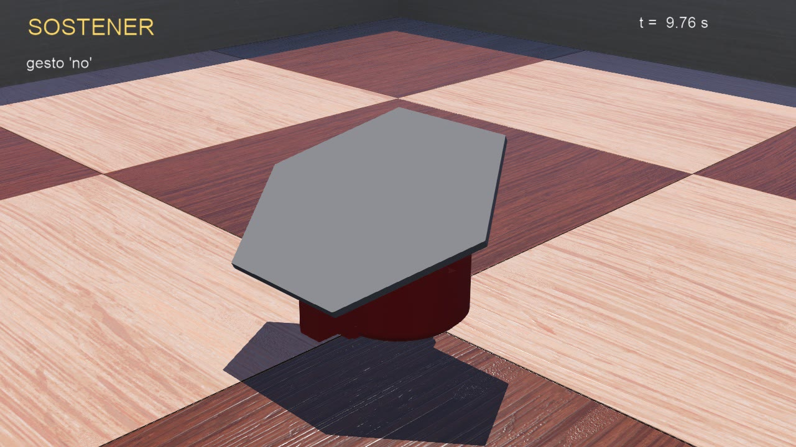

# SOFIA – Máquinas de estado con una unidad de 2 GDL

Archivos para reproducir los ejemplos de la clase **Máquinas de estado** (LabDST, ITESO):

1. **Ciclo de vida de un comando**: máquina de eventos como tabla (diccionario) en Python puro.
2. **Secuencia de gestos**: una unidad de SOFIA con `sofia_controller_gestos` en `sofia_world.wbt`; recorre los gestos `'si'`, `'no'` y `'ola'` con los estados ESPERA, MOVER, ASENTAR y SOSTENER.



## Requisitos

- [Webots R2025a](https://cyberbotics.com/) (el mundo está guardado en esa versión).
- Python 3 en el `PATH`. Si Webots no lo encuentra: *Tools → Preferences → Python command* y escribe la ruta a `python.exe`.
- Conexión a internet la primera vez que abras el mundo: Webots descarga de GitHub los PROTO estándar (fondo y arena) y después los guarda en caché.

El controlador solo usa la biblioteca estándar de Python y el módulo `controller` de Webots; no hace falta instalar paquetes.

## Estructura

```
ejemplo1_comando/fsm_comando.py        Ejemplo 1 (se ejecuta fuera de Webots)
webots/
  worlds/
    sofia_world.wbt                    Ejemplo 2
  controllers/
    sofia_controller_gestos/           Controlador del ejemplo 2
  protos/
    sofia.proto                        Modelo de la unidad (q1, q2 y q3, espejo de q2)
    meshes/                            Mallas STL de la unidad
urdf/sofia.urdf                        Descripción URDF de la unidad (origen del PROTO)
salidas_esperadas/                     Lo que debe imprimir cada ejemplo
media/                                 Video y captura de la simulación
cad/                                   Ensambles de la unidad en STL (E001–E004; referencia, no se necesitan para simular)
```

## Cómo probar

### Ejemplo 1 – Comando

```bash
cd ejemplo1_comando
python fsm_comando.py
```

Compara con `salidas_esperadas/salida_fsm_comando.txt`: el evento `crc_error` llega en VALIDADO y se ignora.

### Ejemplo 2 – Secuencia de gestos

1. Abre Webots → *File → Open World…* → `webots/worlds/sofia_world.wbt`.
2. Presiona *Play*. La consola muestra cada transición (ESPERA → MOVER → ASENTAR → … → SOSTENER → … → ESPERA).
3. Compara el primer gesto (`'si'`) con `salidas_esperadas/salida_sofia_controller_gestos.txt` y los tres gestos (≈16 s de simulación) con el video `media/sofia_controller_gestos.mp4`.

Si modificas el mundo, Webots te preguntará si quieres guardarlo; para volver al estado original usa *File → Reload World* sin guardar (o `git checkout -- webots/worlds`).

## Actividad

Copia `webots/controllers/sofia_controller_gestos/` con otro nombre (carpeta y archivo `.py` deben llamarse igual), cambia el campo `controller` de la unidad en `sofia_world.wbt` a ese nombre y extiende la máquina de estados con los estados **DETENIDO** y **FALLA** que se piden en la presentación.
